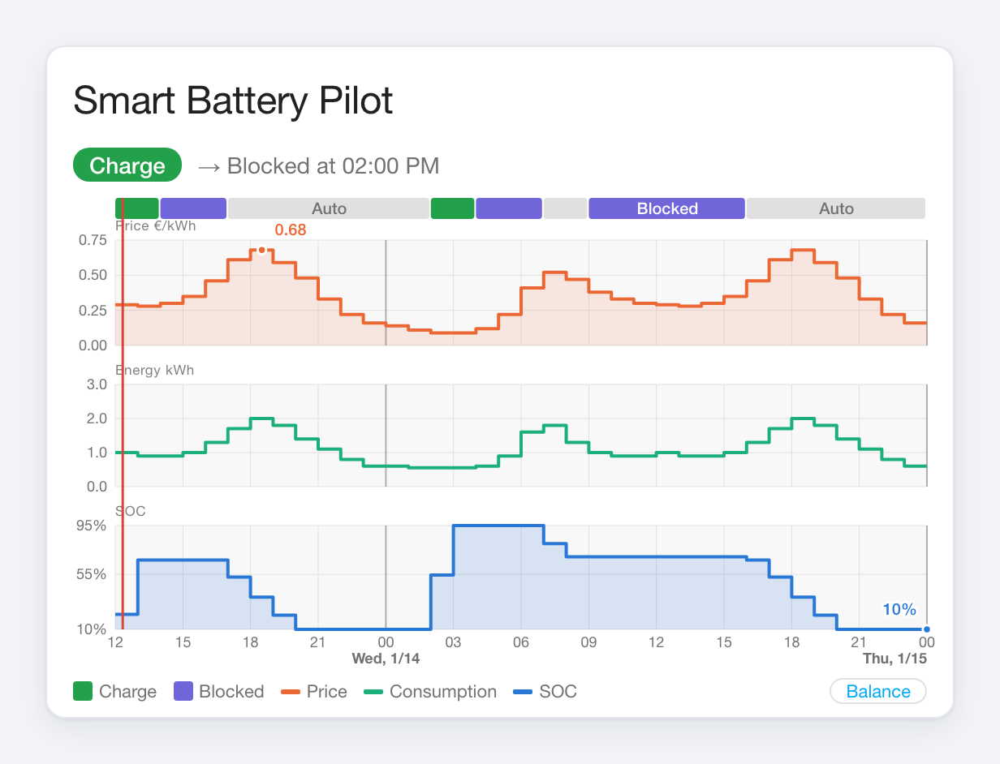
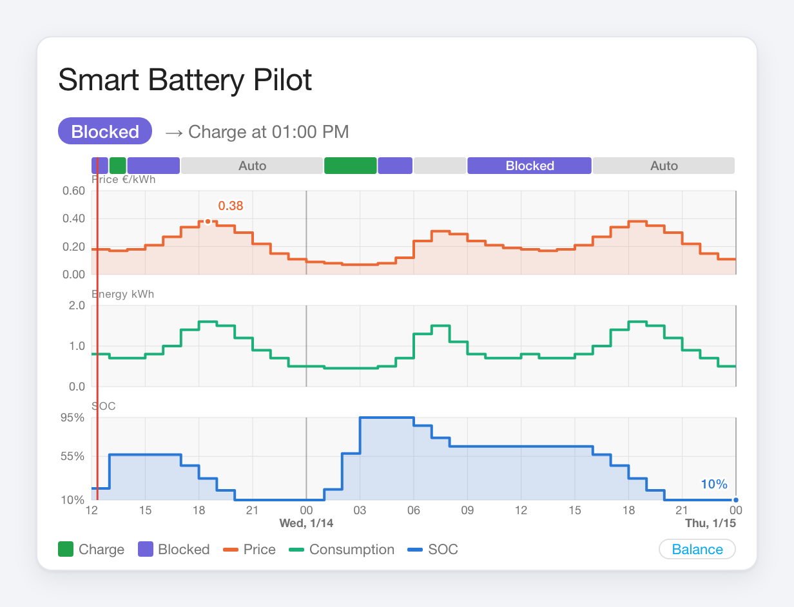
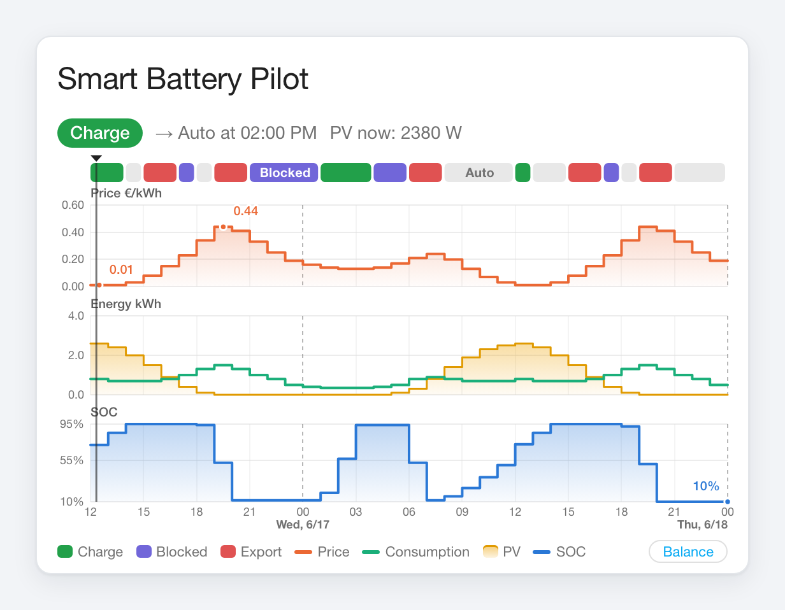
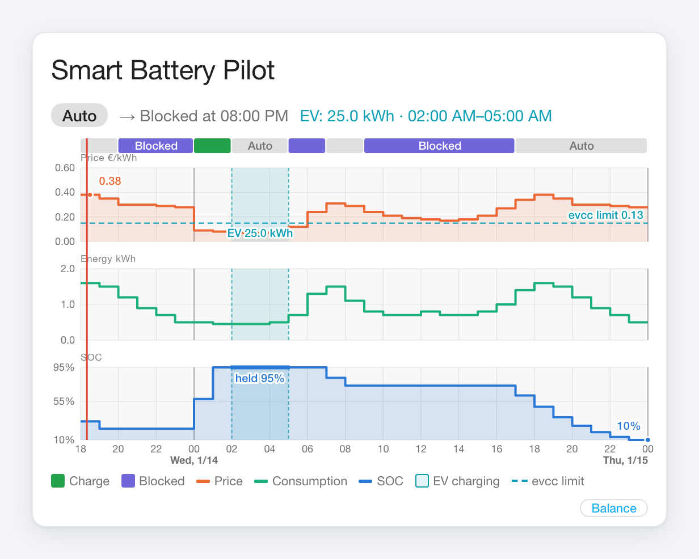
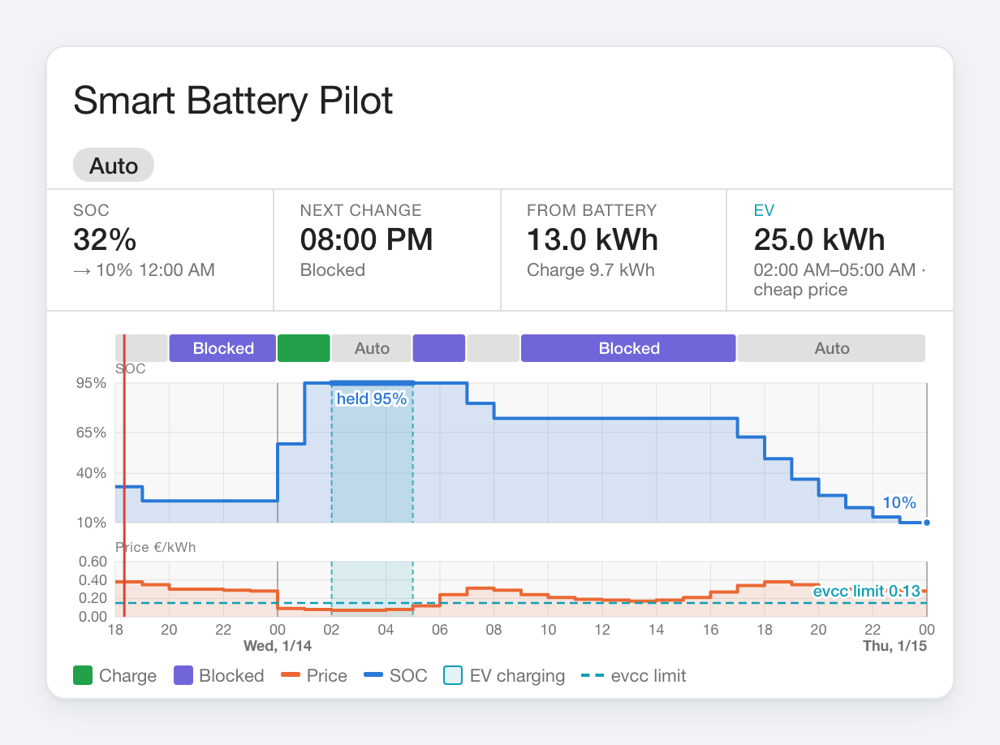
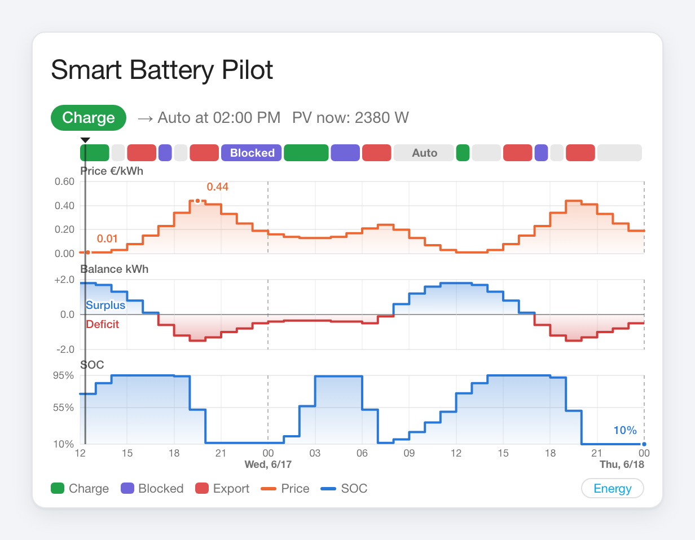
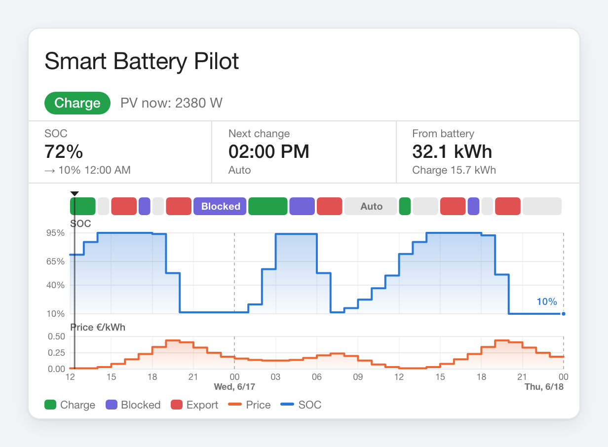
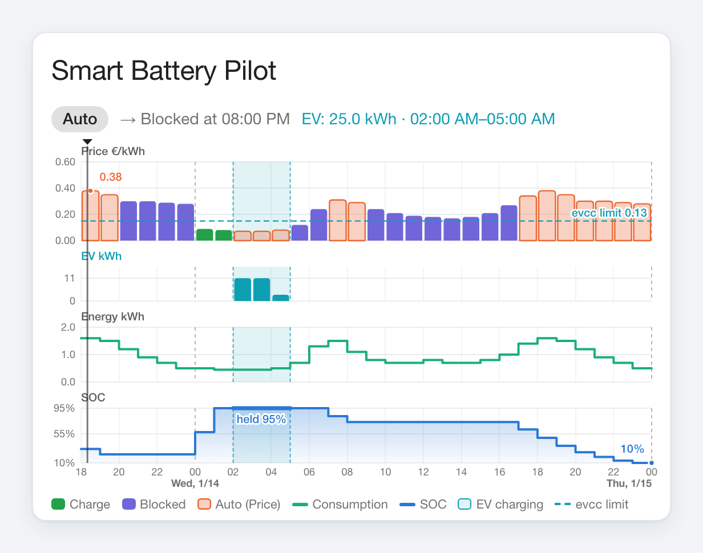
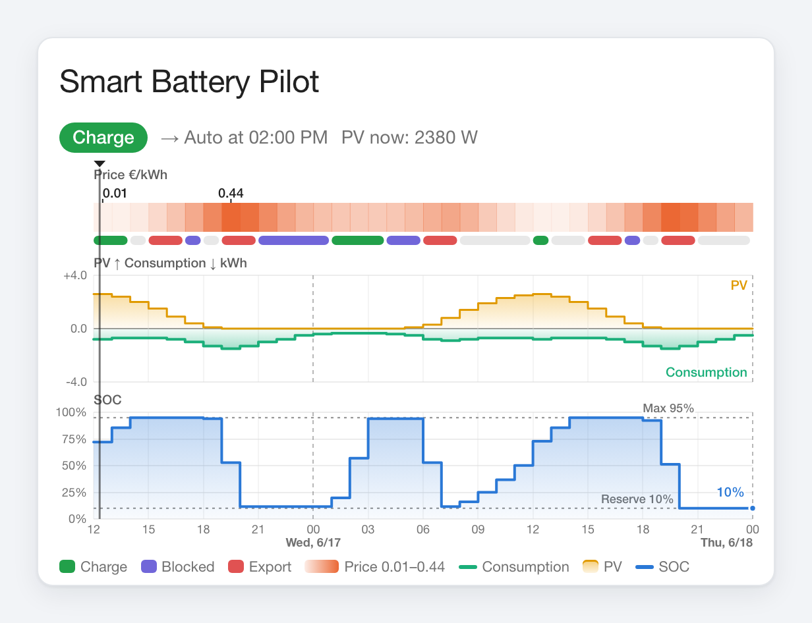

# Smart Battery Pilot

<p align="center">
  
</p>

[![GitHub Release][release-badge]][release-url]
[![GitHub Downloads (all assets, all releases)][downloads-badge]][release-url]
[![Marketplace Default][marketplace-badge]][marketplace-url]
[![HA Version][ha-badge]][ha-url]
[![License][license-badge]][license-url]
[![GitHub commit activity][commits-badge]][commits-url]
[![Validate][validate-badge]][validate-url]
[![GitHub Stars][stars-badge]][stars-url]

**Charge your home battery when electricity is cheap — use it when it's expensive.**

[Project website](https://cygnusb.github.io/ha-smart-battery-pilot/) · [Documentation](https://cygnusb.github.io/ha-smart-battery-pilot/docs/) · [Releases](https://github.com/cygnusb/ha-smart-battery-pilot/releases)

Smart Battery Pilot is a Home Assistant integration for households with a home
battery and a dynamic electricity tariff (Tibber, aWATTar, Octopus Energy,
Ostrom, Voltego, Rabot Charge, Lichtblick, …). It learns your household's
consumption profile, combines it with
the price forecast for the next 24–36 hours and your PV production forecast,
and computes an optimal charge/discharge plan — especially valuable during
dark winter weeks ("Dunkelflaute") when prices swing heavily within a day.

The integration is **vendor neutral**: it controls your battery through Home
Assistant scripts that *you* define, so it works with any inverter/battery
combination that can be controlled from Home Assistant (Fronius, Victron, SMA,
Sungrow, E3DC, Zendure, …). See [docs/examples](docs/examples/) for ready-to-use
vendor configurations.

<p align="center">
  <a href="https://raw.githubusercontent.com/cygnusb/ha-smart-battery-pilot/main/assets/screenshots/card_dunkelflaute_light.png">
    
  </a>
  <br>
  <em>The bundled dashboard card on a Dunkelflaute day: charge in the cheap night, hold the battery for the evening peak.</em>
</p>

## How it works

1. **Price forecast** — the price entity of your existing tariff integration is
   parsed automatically (15-minute or hourly slots, today + tomorrow). Supported
   price integrations: Nordpool, EPEX Spot, ENTSO-E, aWATTar and any
   integration that exposes the price list as a sensor attribute. Integrations
   that only offer the forecast through a service call (such as the official
   Home Assistant Tibber and Nord Pool integrations) need a small
   [bridge sensor](docs/price-bridges.md).
2. **Consumption forecast** — a lightweight model (pure Python, no heavy ML
   dependencies) is trained daily from your Home Assistant history: hour of
   day, weekday/weekend and optionally outdoor temperature (heat pump aware).
3. **PV forecast** — optional; expected solar production is subtracted so the
   plan only covers the *net* grid demand, and forecasted PV surplus is
   modeled as battery charging in the SOC simulation — so on sunny days the
   planner doesn't lock the battery needlessly. Daily forecast sensors are
   spread over the daylight hours; integrations that feed the Energy
   dashboard (Forecast.Solar, Open-Meteo Solar Forecast, Solcast, Helios …)
   can supply their hourly curve instead, so an east roof gets its morning.
4. **Optimization** — a deterministic planner pairs the cheapest charge slots
   with the most expensive consumption slots, respecting battery capacity,
   power limits, SOC limits and roundtrip efficiency. Charging only happens if
   the price spread exceeds your configured threshold (default 0.20 EUR/kWh).
   Optionally it plans with the reduced charge power of a **cold battery** and
   keeps a **backup reserve** that arbitrage never spends.
5. **Execution** — at every slot boundary the integration calls your scripts:
   *force charge*, *block discharge (idle)*, *auto mode* or optionally
   *export to grid* — each with the variable `reserve_soc`, and the power
   scripts with `power_w`.
6. **Accounting** — from your battery's energy meters it reports what the
   battery is worth and, separately, what the pilot itself added.

The pilot also checks that what it plans really happens: if charge slots don't
charge, an idle slot leaks, PV surplus never reaches the battery, the battery
runs below the backup reserve or the SOC sensor is frozen, it says so under
*Settings → Repairs*
([consistency checks](docs/configuration.md#consistency-checks)).

### Actions

| Action   | Meaning                                                        |
|----------|----------------------------------------------------------------|
| `charge` | Force-charge from the grid at the planned power                |
| `auto`   | Self-consumption — battery covers the house, PV surplus charges it |
| `idle`   | Discharging blocked — preserve energy for more expensive hours |
| `export` | Force-discharge into the grid (optional arbitrage mode)        |

## What you need

* **A battery you can control from Home Assistant**, through scripts you write
  for *force charge*, *block discharge* and *auto mode*. In auto mode the battery
  has to cover the house and charge from PV surplus, either by itself or with an
  automation ([what an auto slot assumes](docs/optimizer.md#what-an-auto-slot-assumes)).
* **A price sensor** from your tariff integration, with the price forecast in its
  attributes.
* **Its SOC** as a sensor, in percent.
* **A sensor for the house consumption** with long-term statistics, so the
  forecast can learn from it.
* **Optional:** a PV forecast, and battery charge and discharge energy meters for
  the savings figures.

[Getting started](docs/getting-started.md) walks through all of it, from the
signals to going live.

## Installation

Smart Battery Pilot is in the default catalog of the Marketplace, which is
built into Home Assistant since 2026.11. On older versions the same catalog is
HACS. Either way, no custom repository is needed:

[![Open your Home Assistant instance and show this repository in the Marketplace.][my-marketplace-badge]][my-marketplace-url]

1. On Home Assistant 2026.11 or newer, go to Settings → Marketplace, search for
   **Smart Battery Pilot** (or use the button above) and install it. On older
   versions, search for it in HACS, download it and restart Home Assistant.
2. Settings → Devices & Services → *Add Integration* → **Smart Battery Pilot**.
3. Write the control scripts and go live step by step:
   [Getting started](docs/getting-started.md).

## Configuration

The config flow guides you through five steps: price source, battery
parameters, control scripts, consumption sensor and (optional) PV forecast.
Details and the full option reference: [docs/configuration.md](docs/configuration.md).

Three features live only in the options menu (*Configure* on the integration)
and are off until you switch them on:

* **[Cold-weather charging](docs/configuration.md#cold-weather-charging)** —
  plans with the reduced charge power of a cold battery and learns the real
  limit from the charge slots the pilot runs.
* **[Backup reserve](docs/configuration.md#backup-reserve)** — SOC kept for a
  grid outage that arbitrage never spends, refilled by a deadline, handed to
  every script as `reserve_soc`, and adjustable at runtime through an entity
  (e.g. on a storm warning).
* **[EV charging & other controllers](docs/ev-charging.md)** — keeps the car
  out of the consumption forecast, blocks discharging while an EV charges or
  pauses while evcc holds the battery, and shows sessions evcc has planned in
  the plan ahead of time. Works with any wallbox.

> **Safety first:** the integration starts **disabled** and in **dry-run**
> mode. Watch the planned actions in the log and the plan sensor for a day or
> two, then turn **on** the master switch (still dry-run) and only afterwards
> turn **off** dry-run.

## Entities

| Entity                                   | Description                                  |
|------------------------------------------|----------------------------------------------|
| `sensor.…_current_action`                | Action prescribed right now                  |
| `sensor.…_next_action`                   | Next action change (+ time, price)           |
| `sensor.…_current_price`                 | Price of the active plan slot                |
| `sensor.…_charge_plan`                   | Full plan as `slots` attribute               |
| `sensor.…_plan_status`                   | Plan validity (`ok` / `no_price_data` / …)   |
| `sensor.…_estimated_savings`             | Plan vs. doing nothing, over the horizon     |
| `sensor.…_actual_savings_eur`            | **Battery benefit (net)** — what the battery is worth, pilot or not: discharge at the import price, minus charge cost (grid at import, PV at feed-in). Entity id kept from before the rename |
| `sensor.…_battery_gross_eur`             | **Battery benefit (gross)** — discharge at the grid price, no charge cost deducted |
| `sensor.…_pilot_savings_eur`             | **Pilot savings** — what the pilot itself added: energy it charged from the grid or held back, credited when used (`pending_kwh`: not used yet). 0.00 while it only runs `auto` |
| `sensor.…_actual_savings_kwh`            | Accumulated kWh (discharge − charge)         |
| `sensor.…_consumption_forecast`          | Learned 24h consumption forecast             |
| `sensor.…_configuration`                 | Active settings, incl. charge factor and backup reserve with their sources |
| `switch.…_enabled`                       | Master switch                                |
| `switch.…_dry_run`                       | Plan only, don't call scripts                |
| `binary_sensor.…_plan_problem`           | On when no valid plan exists                 |

The three euro totals and the kWh total stay empty until **both** optional
battery charge and discharge energy entities are configured. *Battery benefit*
counts whether or not the pilot steers — it is what the battery is worth.
*Pilot savings* counts only what the pilot moved differently from the
inverter: grid charge in `charge` slots and energy held back in `idle` slots,
valued when the battery later discharges it. See
[docs/optimizer.md](docs/optimizer.md#savings-estimate).

`estimated_savings` is measured against doing nothing (plain self-consumption),
not against buying everything from the grid: a plan that changes nothing
reports `0.00`. See [docs/optimizer.md](docs/optimizer.md#savings-estimate).

> Entity IDs are generated from the **localized** entity names when an entity
> is first created — on a German installation the plan sensor is
> `sensor.smart_battery_pilot_ladeplan`, on an English one
> `sensor.smart_battery_pilot_charge_plan`. Renaming an entity later (as with
> *Battery benefit (net)*) changes its display name, not its id. See
> [Languages](#languages) for the ten UI languages shipped.

Service: `smart_battery_pilot.replan` — recompute the plan immediately.

When something looks wrong, download the diagnostics (device page → ⋮ →
*Download diagnostics*): the inputs of the last plan, the plan itself and the
executor's last 50 decisions with their reasons. Attach it to any issue
report. Debug logging, what each plan status means and answers to common
questions such as "why doesn't it charge?" are in
[Troubleshooting & FAQ](docs/troubleshooting.md).

## Dashboard card

The integration ships its own Lovelace card, registered automatically as a
Lovelace resource:

```yaml
type: custom:smart-battery-pilot-card
entity: sensor.smart_battery_pilot_charge_plan   # optional - auto-discovered
view: tracks                                     # optional - tracks | balance | bars | flow | compact
height: auto                                     # optional - auto | <pixels> | <percent>
```

Every quantity gets its own panel and its own scale: the price, PV against
household consumption, and the SOC forecast within the battery's min/max
window. The card draws at the size the dashboard gives it, from a phone column
to a full-width panel. Views, sizing and YAML dashboards (which need the
resource added by hand): [Dashboard card](docs/dashboard.md).

Click an image to open it at full resolution. The energy panel also flips to the balance with the button in
the legend.

<table>
<tr>
<td align="center" valign="top" width="50%">
<a href="https://raw.githubusercontent.com/cygnusb/ha-smart-battery-pilot/main/assets/screenshots/card_winter_arbitrage_light.png"></a><br>
<sub><b>Winter arbitrage</b> — charge through the cheap night, hold the battery for the evening peak.</sub>
</td>
<td align="center" valign="top" width="50%">
<a href="https://raw.githubusercontent.com/cygnusb/ha-smart-battery-pilot/main/assets/screenshots/card_summer_export_light.png"></a><br>
<sub><b>Summer PV export</b> — PV fills the battery, the evening peak is sold to the grid.</sub>
</td>
</tr>
<tr>
<td align="center" valign="top" width="50%">
<a href="https://raw.githubusercontent.com/cygnusb/ha-smart-battery-pilot/main/assets/screenshots/card_ev_overnight_light.png"></a><br>
<sub><b>EV charging with evcc</b> — the planned overnight session, evcc's price limit, and the house battery charged beforehand and held while the car charges.</sub>
</td>
<td align="center" valign="top" width="50%">
<a href="https://raw.githubusercontent.com/cygnusb/ha-smart-battery-pilot/main/assets/screenshots/card_ev_compact_light.png"></a><br>
<sub><b>Compact view with EV</b> — the planned car session gets its own tile next to SOC, next change and battery energy.</sub>
</td>
</tr>
<tr>
<td align="center" valign="top" width="50%">
<a href="https://raw.githubusercontent.com/cygnusb/ha-smart-battery-pilot/main/assets/screenshots/card_view_balance_light.png"></a><br>
<sub><code>view: balance</code> — PV <b>minus</b> consumption, the quantity the optimizer plans against.</sub>
</td>
<td align="center" valign="top" width="50%">
<a href="https://raw.githubusercontent.com/cygnusb/ha-smart-battery-pilot/main/assets/screenshots/card_view_compact_light.png"></a><br>
<sub><code>view: compact</code> — status, next change and planned discharge as figures, curves underneath. For overview dashboards and phones.</sub>
</td>
</tr>
<tr>
<td align="center" valign="top" width="50%">
<a href="https://raw.githubusercontent.com/cygnusb/ha-smart-battery-pilot/main/assets/screenshots/card_view_bars_light.png"></a><br>
<sub><code>view: bars</code> — every price bar in the colour of its planned action; with evcc, a lane for the car's energy.</sub>
</td>
<td align="center" valign="top" width="50%">
<a href="https://raw.githubusercontent.com/cygnusb/ha-smart-battery-pilot/main/assets/screenshots/card_view_flow_light.png"></a><br>
<sub><code>view: flow</code> — the price as a colour band, PV up and consumption down, the battery with its operating window.</sub>
</td>
</tr>
</table>

All of them are real plans: [`tools/gen_card_screenshots.py`](tools/gen_card_screenshots.py)
describes a day of prices, consumption, PV and (for the EV shots) a
charging session evcc has planned, runs it through the actual optimizer and
renders the card against the result, in a light and a dark theme.

## Vendor examples

* [BYD Battery-Box Premium HVM + Fronius Gen24 (Modbus TCP)](docs/examples/byd-fronius-gen24.md)
* [Zendure SolarFlow 2400 AC+ (AC-coupled, separate PV inverter)](docs/examples/zendure-solarflow-ac-plus.md)
* [Add your setup](docs/examples/TEMPLATE.md) — PRs welcome!

## How the optimizer decides

See [docs/optimizer.md](docs/optimizer.md) for the algorithm, the savings
estimate and worked examples.

## Languages

The setup flow, the entity states, the repair messages and the dashboard card are
available in
English, German, Dutch, Swedish, Norwegian (Bokmål), Danish, Finnish,
Estonian, Latvian and Lithuanian — chosen to match where dynamic tariffs are
common and the supported price sources reach (Nordpool, Tibber, aWATTar,
EPEX Spot, ENTSO-E). Home Assistant falls back to English for any other
language.

Everything except English and German was translated without a native
speaker's review, and the vocabulary here is full of inverter jargon —
**corrections are very welcome.** A language lives in three places:

* `custom_components/smart_battery_pilot/translations/<lang>.json` — setup
  flow, entity names and states, repair messages
* the `TRANSLATIONS` table in
  `custom_components/smart_battery_pilot/frontend/smart-battery-pilot-card.js`
  — the dashboard card, which is plain JS and cannot read the files above
* `site/i18n/<lang>.json` — the [project website](https://cygnusb.github.io/ha-smart-battery-pilot/),
  built by `tools/build_site.py` (the documentation pages stay English)

`pytest tests/test_translations.py` holds every language to the same keys as
English, checks that each form field is both labelled and explained, that no
file was left in English, that the card covers the same languages, and that
the card's `{entity}` / `{error}` / `{action}` / `{time}` placeholders
survived. Adding a language is a matter of copying `en.json`, translating it,
and adding a block to the card table — the tests will tell you what you
missed.

## License

MIT

[release-badge]: https://img.shields.io/github/v/release/cygnusb/ha-smart-battery-pilot?include_prereleases
[release-url]: https://github.com/cygnusb/ha-smart-battery-pilot/releases
[downloads-badge]: https://img.shields.io/github/downloads/cygnusb/ha-smart-battery-pilot/total
[marketplace-badge]: https://img.shields.io/badge/Marketplace-Default-41BDF5.svg
[marketplace-url]: https://www.home-assistant.io/integrations/marketplace/
[my-marketplace-badge]: https://my.home-assistant.io/badges/marketplace_repository.svg
[my-marketplace-url]: https://my.home-assistant.io/redirect/marketplace_repository/?owner=cygnusb&repository=ha-smart-battery-pilot&category=integration
[ha-badge]: https://img.shields.io/badge/HA-2024.11.0+-blue.svg
[ha-url]: https://www.home-assistant.io/
[license-badge]: https://img.shields.io/github/license/cygnusb/ha-smart-battery-pilot
[license-url]: https://github.com/cygnusb/ha-smart-battery-pilot/blob/main/LICENSE
[commits-badge]: https://img.shields.io/github/commit-activity/y/cygnusb/ha-smart-battery-pilot
[commits-url]: https://github.com/cygnusb/ha-smart-battery-pilot/commits/main
[validate-badge]: https://img.shields.io/github/actions/workflow/status/cygnusb/ha-smart-battery-pilot/validate.yml?label=validate&logo=github
[validate-url]: https://github.com/cygnusb/ha-smart-battery-pilot/actions/workflows/validate.yml
[stars-badge]: https://img.shields.io/github/stars/cygnusb/ha-smart-battery-pilot?style=flat
[stars-url]: https://github.com/cygnusb/ha-smart-battery-pilot/stargazers
