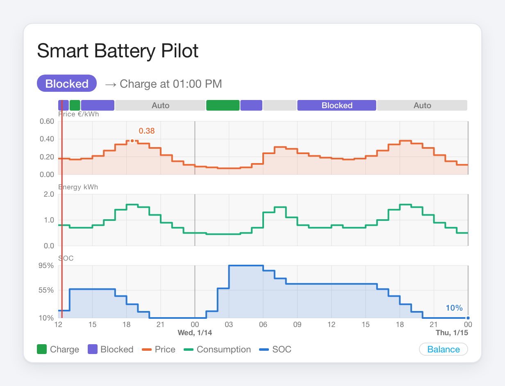
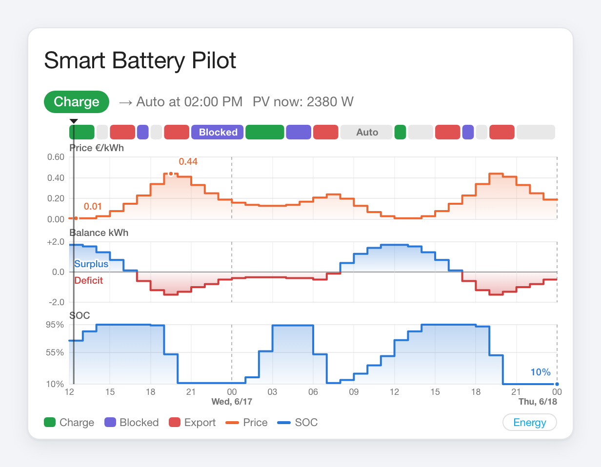
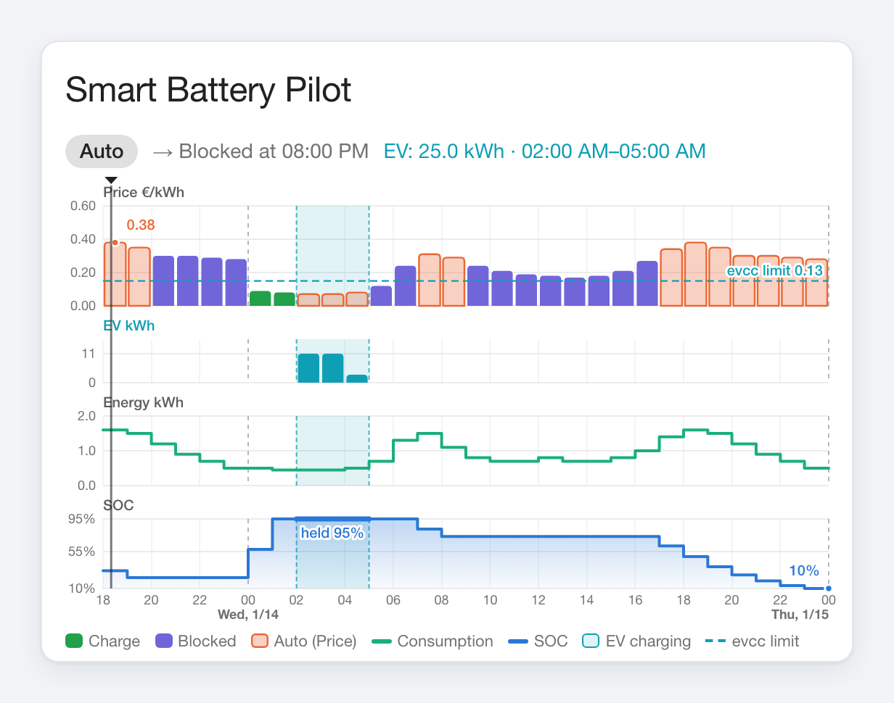
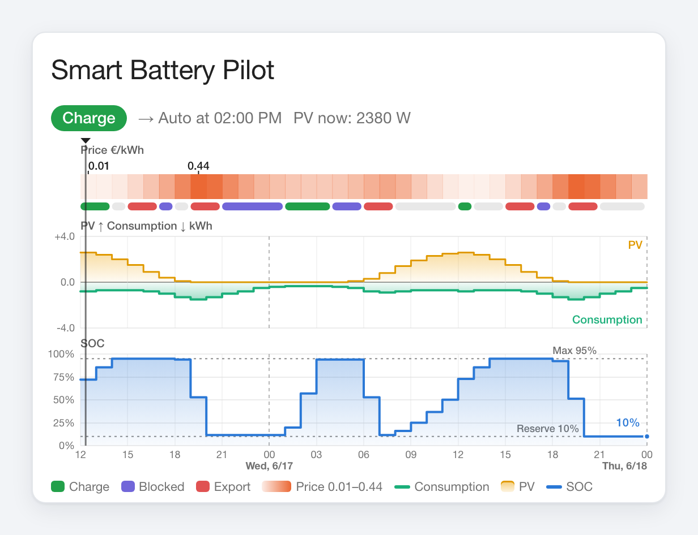
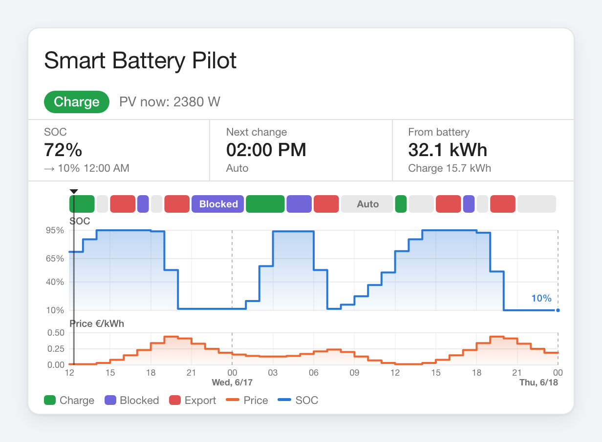
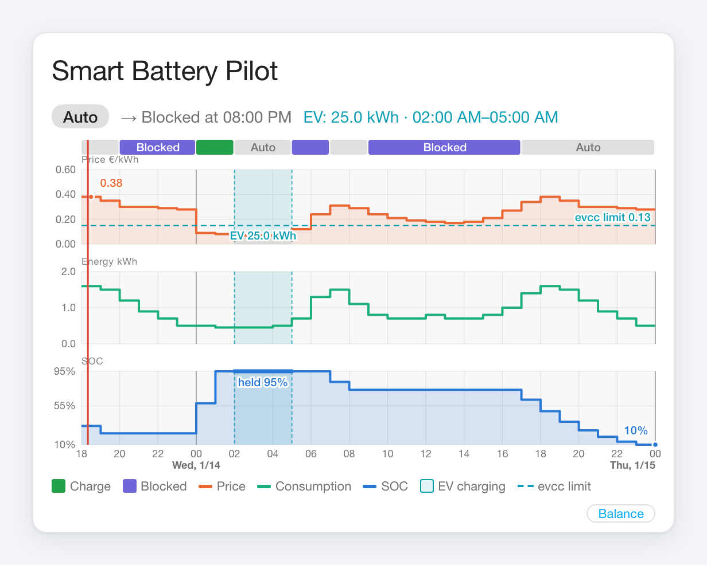

# Dashboard card

The integration ships its own Lovelace card. On a dashboard in storage mode
(the default) it is registered as a resource automatically; for YAML
dashboards see [below](#yaml-dashboards).

```yaml
type: custom:smart-battery-pilot-card
entity: sensor.smart_battery_pilot_charge_plan  # optional - auto-discovered
title: Smart Battery Pilot                      # optional
view: tracks                                    # optional - tracks | balance | bars | flow | compact
height: auto                                    # optional - auto | <pixels> | <percent>
```

`entity` may be omitted — the card auto-discovers the plan sensor (entity IDs
are localized, e.g. `…_ladeplan` on German installations).

## Size

The card measures the box the dashboard gives it and draws at that size: one
SVG unit is one CSS pixel, so axis labels stay 9 px and strokes stay 2 px
whether the card is 300 px wide in a phone column or 1600 px wide in a panel
view. Extra width buys a denser hour grid (down to one label per hour) and
extra height buys taller panels with more y-axis ticks, rather than magnifying
everything.

| `height` | Effect |
|---|---|
| omitted, or `auto` *(default)* | Grows gently with width and then stops: roughly 236–440 px in `tracks`, `balance` and `flow`, 250–460 px in `bars`, 158–300 px in `compact`. |
| a number, e.g. `height: 320` | Exactly that many pixels for the chart. Accepts `"320px"` too. Panels shrink to a 30 px floor, below which the card grows back. |
| a percentage, e.g. `height: "100%"` | Fills the box the dashboard offers, minus the status line and legend. Only useful where that box has a height of its own — a sections-view card with `grid_options.rows` set, or a `card_mod` wrapper. Elsewhere it falls back to `auto`. |

In a **sections** view a card occupies 12 of the section's sub-columns by
default, and a section has 12 sub-columns per macro column it spans — so in a
`column_span: 3` section the default fills one third of it. To use the whole
section:

```yaml
type: custom:smart-battery-pilot-card
grid_options:
  columns: full
```

## Views

One scale per drawing surface. Price per kWh, energy in kWh and SOC in
percent are three different units, and stacking them on a single plot means
two of them have to be squeezed into whatever space the third leaves — which
is how a correct consumption forecast ends up drawn along the baseline on a
strong PV day.

| `view` | What it draws |
|---|---|
| `tracks` *(default)* | Three panels sharing one time axis: price, PV against consumption, SOC. |
| `balance` | Same three panels, but the middle one shows PV **minus** consumption as an area diverging around zero — the quantity the optimizer plans against. |
| `bars` | Price as one bar per slot in the colour of the action planned for it, which replaces the ribbon; PV against consumption; SOC. With EV charging on the plan, a lane under the price shows the car's planned kWh per slot on a scale of its own, and evcc's price limit runs across the bars. |
| `flow` | Price as a band of one orange that darkens with the price (cheapest and dearest slot labeled above it), the action ribbon directly under it, PV drawn upwards and consumption downwards around zero, and the SOC across 0–100 % with the reserve (`min_soc`) and ceiling (`max_soc`) as dashed lines. With EV charging, the same car lane as in `bars`, and a dot on every slot cheap enough to be under evcc's limit. |
| `compact` | Status line, three figures (SOC now → at horizon end, next change, planned discharge) and a smaller SOC + price chart. Roughly two thirds the height; below 420 px the three figures are set smaller so they stay on one line. With an EV charging session on the plan a fourth figure shows it (energy, time span, why evcc charges) in place of the status-line summary; below 420 px the four go two by two. |

| View | |
|---|---|
| `tracks`<br>A winter day: charge in the cheap night, hold the battery for the evening peak. | { width="420" } |
| `balance`<br>PV **minus** consumption, the quantity the optimizer plans against. | { width="420" } |
| `bars`<br>Every price bar in the colour of its planned action; with evcc, a lane for the car. | { width="420" } |
| `flow`<br>The price as a colour band, PV up and consumption down, the SOC with its window. | { width="420" } |
| `compact`<br>Figures first, for phones and overview dashboards. | { width="420" } |
| `tracks` with evcc<br>A planned overnight session, evcc's price limit, and the battery charged beforehand and held for the car. | { width="420" } |

An unrecognised value falls back to `tracks`. The button at the right of the
legend flips between `tracks` and `balance` without editing the dashboard;
it resets to the configured view whenever the card config is re-applied.

Common to every view: planned actions (charge/blocked/export/auto) — as a
labeled band across the top, as the colour of the price bars in `bars`, as a
thin band under the price in `flow` — local-midnight day separators with the date,
a "now" marker, the most expensive and the cheapest slot labeled on the
price, the SOC endpoint labeled, and a hover marker on every curve with a
tooltip showing time slot, action, price, SOC forecast, PV and net demand.

With planned EV sessions (evcc), every view adds the charging windows as a
band through all panels, the slots where the battery is held for the car as a
thick SOC segment, and, where it fits on the price axis, evcc's price limit as
a dashed line. The tooltip names the EV energy, why evcc charges, and evcc's
own limit for slots it picked for their price. A plan without EV charging
looks exactly as before, apart from one line in the status bar that says
how the charger stands (car SOC and "no charging planned", "not plugged in" or
"evcc not reachable"). See [EV charging](ev-charging.md#planned-sessions-evcc).

Apart from `flow`, the SOC panel is drawn against the battery's configured window (`min_soc` to
`max_soc`, published on the plan sensor) instead of 0–100 %, so the discharge
depth uses the panel's full height rather than a sliver along the top edge.

## Language

The card's labels, tooltip and date/time formatting follow the Home Assistant
user's language (`hass.locale.language`, falling back to the browser language
and finally to English). The card ships the same ten languages as the
integration (English, German, Danish, Estonian, Finnish, Lithuanian, Latvian,
Norwegian Bokmål, Dutch, Swedish); to add another, extend the `TRANSLATIONS`
table at the top of
`custom_components/smart_battery_pilot/frontend/smart-battery-pilot-card.js`
with a new entry keyed by the language tag — any key missing from it falls back
to the English string.

## YAML dashboards

With `lovelace: resource_mode: yaml` the resource list is read-only, so the
card cannot be added automatically. Add it yourself:

```yaml
lovelace:
  resource_mode: yaml
  resources:
    - url: /smart_battery_pilot/smart-battery-pilot-card.js
      type: module
```

Without it the card may intermittently be missing after a page load
([#47](https://github.com/cygnusb/ha-smart-battery-pilot/issues/47),
[home-assistant/frontend#53890](https://github.com/home-assistant/frontend/issues/53890)).

## ApexCharts instead

The plan sensor's `slots` attribute carries everything the card draws, so other
cards can chart it too. With [ApexCharts Card](https://github.com/RomRider/apexcharts-card):

```yaml
type: custom:apexcharts-card
header: { show: true, title: Price & charge plan }
graph_span: 36h
span: { start: hour }
series:
  - entity: sensor.smart_battery_pilot_charge_plan
    name: Price
    data_generator: |
      return entity.attributes.slots.map(s => [new Date(s.start), s.price]);
    type: line
  - entity: sensor.smart_battery_pilot_charge_plan
    name: SOC forecast
    data_generator: |
      return entity.attributes.slots.map(s => [new Date(s.start), s.soc_forecast]);
    type: line
    yaxis_id: soc
yaxis:
  - id: price
  - id: soc
    opposite: true
    max: 100
```
